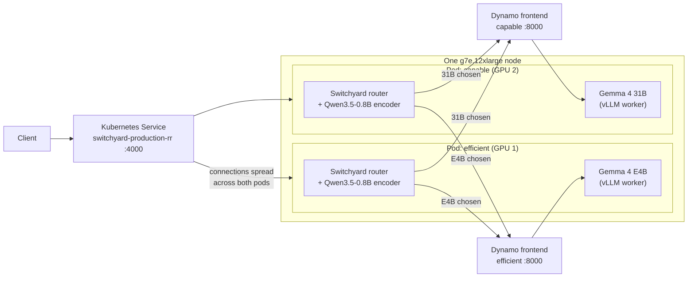

# Switchyard + Dynamo shopping router

A trained [Switchyard](https://github.com/NVIDIA-NeMo/Switchyard) prefill router picks, for each Shopping MMLU question, between Gemma 4 E4B (`efficient`) and Gemma 4 31B (`capable`). A small Qwen3.5-0.8B encoder reads the question once and predicts how likely each model is to answer it correctly. Both models run on [Dynamo](https://github.com/ai-dynamo/dynamo) on a single two-GPU `g7e.12xlarge`: one GPU holds a model worker plus a copy of the router, and a Kubernetes Service spreads traffic across the two router copies.

> **Status: experimental.** This is a working demo and benchmark, not a production path. It runs a pinned Switchyard build with local patches for toolkit-checkpoint compatibility, tolerance routing, and encoder performance, plus patches to the model-router toolkit. The patches are specific to this demo and have not been proposed upstream. [PATCHES.md](PATCHES.md) lists each one, what it does, and what it would take to upstream.

| GPU | Dynamo deployment | Processes |
| --- | --- | --- |
| 1 | `efficient` | Gemma 4 E4B worker + router |
| 2 | `capable` | Gemma 4 31B worker + router |



Either router copy can receive a request. It scores the question once, then sends it to the frontend of whichever model it picks, so a request that lands on the `efficient` pod may still be answered by the 31B worker.

## Results

500 held-out questions (400 easy, 100 hard), one `g7e.12xlarge`, same workload for every setup.

| | 31B only | Switchyard |
| --- | ---: | ---: |
| Accuracy (clean questions) | 95.2% | 93.6% |
| Requests/s answered within 1 s (95% of requests) | 95.56 | 159.63 |
| Instance cost per 1,000 such requests | $0.042 | $0.025 |

That is 1.67x the throughput, or about 40% lower instance cost per compliant request, for 1.6 points of accuracy. E4B alone scores 83.2%. The percentage does not depend on the hourly price because both setups use the same instance. Dollar figures use the eu-west-2 on-demand rate of $14.40172/hour (checked against the AWS Price List API on 2026-10-12). See [Limits](#limits) before quoting any of this.

## What is in the repo

| Path | Contents |
| --- | --- |
| `manifests/dynamo/` | The two Dynamo Graph Deployments (DGDs) and the model prefetch Job |
| `manifests/router/` | Router routes, launch scripts, runtime builder Pod, and Service |
| `manifests/benchmark/` | 2×E4B and 2×31B baseline DGDs, and a Kustomize overlay that switches the Switchyard DGDs to benchmark mode |
| `manifests/aiperf/` | Load-generator Pod |
| `scripts/deploy-eks.sh` | Applies the DGDs and Service |
| `scripts/shopping-mmlu/` | Runtime build script and the clean-accuracy runner |
| `scripts/aiperf/` | Input prep, node check, sweep runner, point validator, summarizer |
| `patches/` | Switchyard and toolkit patches, plus the batching overlays |
| `benchmark/` | Frozen test set, router checkpoint, policy, rate schedule, and the raw AIPerf results behind the table above |
| `PATCHES.md` | Inventory of every local patch and overlay, with upstream tracking notes |
| `THIRD_PARTY_NOTICES.md`, `licenses/` | Attribution for upstream code and data used here |

## Prerequisites

- EKS with the Dynamo operator and a `dynamo` namespace.
- One node labeled `workload=model-serving` (`g7e.12xlarge`, 2 GPUs). If other nodes carry that label, add node affinity.
- For benchmarking, one `c7i.2xlarge` labeled `workload=aiperf` (optionally tainted `benchmark=aiperf:NoSchedule`).
- Secret `hf-token-secret` in `dynamo` with key `HUGGING_FACE_HUB_TOKEN` and access to the gated Gemma repos.
- Runtime image `nvcr.io/nvidia/ai-dynamo/vllm-runtime:1.4.0`.
- Source checkouts, not vendored here: [Switchyard](https://github.com/NVIDIA-NeMo/Switchyard) at `a601a9a3f9db149a1ad430fa43b1463a170c8a82`, and [llm-router](https://github.com/NVIDIA-AI-Blueprints/llm-router) branch `v3` at `8a9d3509fbde879d9795258081bab9553b458e04`. From llm-router you need its `src/` directory, not the repo root.
- `kubectl`, and Python 3 with `numpy` and `openai` for the local scripts and tests.

## 1. Prepare models and the Switchyard runtime

Download the pinned model snapshots to the node, then start the builder Pod.

```bash
kubectl apply -f manifests/dynamo/prefetch-job.yaml
kubectl -n dynamo wait --for=condition=complete job/prefetch-models --timeout=60m
kubectl apply -f manifests/router/colocated-builder.yaml
kubectl -n dynamo wait --for=condition=Ready pod/switchyard-colocated-builder --timeout=10m
```

The prefetch Job has a short TTL, so check it promptly. The builder's `/runtime` is the same node directory the workers mount as `/router-runtime`.

Copy in the sources, patches and launchers, then build once against fresh (unpatched) source:

```bash
kubectl -n dynamo cp /path/to/switchyard-src switchyard-colocated-builder:/runtime/switchyard-src
kubectl -n dynamo cp /path/to/llm-router/src switchyard-colocated-builder:/runtime/llm-router-src
kubectl -n dynamo cp patches switchyard-colocated-builder:/runtime/patches
kubectl -n dynamo cp scripts/shopping-mmlu/restore-colocated-runtime.sh switchyard-colocated-builder:/runtime/restore-colocated-runtime.sh
kubectl -n dynamo exec switchyard-colocated-builder -- bash /runtime/restore-colocated-runtime.sh

kubectl -n dynamo cp manifests/router/colocated-routes.toml switchyard-colocated-builder:/runtime/routes.toml
kubectl -n dynamo cp manifests/router/start-efficient-router.sh switchyard-colocated-builder:/runtime/start-efficient-router.sh
kubectl -n dynamo cp manifests/router/start-capable-router.sh switchyard-colocated-builder:/runtime/start-capable-router.sh
kubectl -n dynamo cp benchmark/inputs/prefill_router.pt switchyard-colocated-builder:/runtime/prefill_router.pt
kubectl -n dynamo exec switchyard-colocated-builder -- sha256sum /runtime/prefill_router.pt
kubectl -n dynamo exec switchyard-colocated-builder -- chmod +x /runtime/start-efficient-router.sh /runtime/start-capable-router.sh
```

The checkpoint hash must be `5c3e0704368f248a469d6762252bb3a1257bfd7016c885417de1707488247bdf`. The pickle checkpoint should only be loaded by a trusted runtime.

What the build does: `restore-colocated-runtime.sh` applies `switchyard-prefill-local.patch` (checkpoint loading, tolerance, GPU device) to Switchyard, copies the batching overlays from `patches/batching/` over the prefill-router crate, applies the two toolkit patches with `git apply --unidiff-zero` (they use zero-context hunks), and builds `switchyard-server-profiled` with Rust 1.96.1. It does not download sources. The overlays batch encoder work across requests (up to 16 requests, 2 ms collection window); each request still goes to its chosen model separately. Requests near the routing threshold are rescored individually to reduce batch rounding differences, so recheck routing parity if you change the checkpoint, runtime or batch settings. To turn batching off, omit `SWITCHYARD_PREFILL_MICROBATCH` in the launchers. Keep the launchers' tolerance (`0.1760250329971314`) equal to the one in `colocated-routes.toml`.

## 2. Deploy

```bash
bash scripts/deploy-eks.sh YOUR_KUBE_CONTEXT
kubectl --context YOUR_KUBE_CONTEXT -n dynamo get dgd efficient capable
kubectl --context YOUR_KUBE_CONTEXT -n dynamo get pods -l app=switchyard-production-rr -o wide
kubectl --context YOUR_KUBE_CONTEXT -n dynamo get endpointslices -l kubernetes.io/service-name=switchyard-production-rr
```

The script refuses to run unless exactly one node carries `workload=model-serving`. Expect two ready worker Pods (`switchyard-replica=efficient` and `=capable`) and two Service endpoints. A worker is ready only when both its local Dynamo/vLLM and its local router answer.

To send a request, port-forward `svc/switchyard-production-rr` on port 4000 and POST to `/v1/chat/completions` with model `shopping`. Each replica writes its own routing log if you want to confirm both receive traffic. The Service balances TCP connections, not individual requests, so clients that reuse one connection will skew the split.

By default prefix caching is off in both workers (`SWITCHYARD_PREFIX_CACHE_MODE=disabled`). The launchers accept only `disabled` or `enabled` and exit on anything else.

## 3. Measure clean accuracy

With the default deployment up, run each of the 500 questions once through E4B, 31B and Switchyard. Keep these port-forwards open in three terminals:

```bash
kubectl -n dynamo port-forward svc/efficient-frontend 18000:8000
kubectl -n dynamo port-forward svc/capable-frontend 18001:8000
kubectl -n dynamo port-forward svc/switchyard-production-rr 14000:4000
```

```bash
python3 scripts/shopping-mmlu/tiered-heldout-live.py \
  --input benchmark/inputs/test.jsonl \
  --router-dir benchmark/inputs \
  --checkpoint benchmark/inputs/prefill_router.pt \
  --policy benchmark/inputs/policy.json \
  --costs configs/prefill-router/shopping-costs-token-proxy.json \
  --output-rows output/clean-accuracy-rows.jsonl \
  --output-report output/clean-accuracy-report.json
```

The script checks the hashes of the checkpoint and test set against the policy file and refuses to overwrite existing output. Use this run for accuracy; the AIPerf requests carry a tag in the prompt and are not a clean accuracy measurement.

## 4. Run the throughput benchmark

Three setups run one at a time on the same `g7e.12xlarge`: two E4B workers, two 31B workers, or one of each with a router per GPU. Prefix caching is on for all three. AIPerf 0.13.0 prepends a unique `[rid:<12 hex>]` marker to every user message so repeated questions cannot hit the cache; only the shared system prompt can. For Switchyard, the router strips that marker from its own copy before scoring, and the tagged request still goes to the model.

The rate schedule, 60 s warmup, 300 s measurement window, 1 s latency cutoff and 95% attainment rule are in `benchmark/protocol.json`.

```bash
python3 scripts/aiperf/check-nodes.py --context YOUR_KUBE_CONTEXT
python3 scripts/aiperf/prepare-inputs.py benchmark/inputs/test.jsonl output/benchmark-work \
  --expected-sha256 07882e772a3aa492e97747aa88a83a61ca5975810842e88539ee9b07e2427c64
```

Remove the standard deployment, start the load generator, and copy the inputs in:

```bash
kubectl -n dynamo delete dgd efficient capable
kubectl -n dynamo delete service switchyard-production-rr
kubectl apply -f manifests/aiperf/loadgen.yaml
kubectl -n dynamo wait --for=condition=Ready pod/aiperf-loadgen --timeout=10m
until kubectl -n dynamo exec aiperf-loadgen -- test -f /work/installed; do sleep 5; done
kubectl -n dynamo cp output/benchmark-work/. aiperf-loadgen:/work
kubectl -n dynamo cp scripts/aiperf aiperf-loadgen:/work/scripts-aiperf
kubectl -n dynamo cp benchmark/protocol.json aiperf-loadgen:/work/protocol.json
kubectl -n dynamo exec aiperf-loadgen -- python3 /work/scripts-aiperf/patch-export.py
```

`patch-export.py` is a version-guarded fix that avoids slow, duplicate export in AIPerf 0.13.0; it does not change requests or metrics. Run one AIPerf process at a time. `run-sweep.sh` runs each rate in the protocol, validates the result, and stops at the first valid SLO failure. It never overwrites an existing point.

**E4B only**

```bash
kubectl apply -f manifests/benchmark/dgd-e4b-only.yaml
kubectl -n dynamo wait --for=condition=Ready pod -l benchmark-role=e4b-only --timeout=20m
kubectl -n dynamo exec aiperf-loadgen -- bash /work/scripts-aiperf/run-sweep.sh \
  e4b_only efficient http://efficient-frontend:8000 /work /work/protocol.json
kubectl -n dynamo delete dgd efficient
kubectl -n dynamo wait --for=delete pod -l benchmark-role=e4b-only --timeout=10m
```

**31B only**

```bash
kubectl apply -f manifests/benchmark/dgd-31b-only.yaml
kubectl -n dynamo wait --for=condition=Ready pod -l benchmark-role=capable-only --timeout=20m
kubectl -n dynamo exec aiperf-loadgen -- bash /work/scripts-aiperf/run-sweep.sh \
  capable_only capable http://capable-frontend:8000 /work /work/protocol.json
kubectl -n dynamo delete dgd capable
kubectl -n dynamo wait --for=delete pod -l benchmark-role=capable-only --timeout=10m
```

**Switchyard.** The overlay turns on prefix caching in both workers and sets `SWITCHYARD_STRIP_AIPERF_RID_FOR_ROUTING=1`.

```bash
kubectl kustomize --load-restrictor=LoadRestrictionsNone \
  manifests/benchmark/switchyard-cache-bust | kubectl apply -f -
kubectl -n dynamo wait --for=condition=Ready pod -l app=switchyard-production-rr --timeout=20m
kubectl -n dynamo exec aiperf-loadgen -- bash /work/scripts-aiperf/run-sweep.sh \
  switchyard shopping http://switchyard-production-rr:4000 /work /work/protocol.json
```

Check that both router replicas received traffic. Then copy results back and summarize:

```bash
kubectl -n dynamo cp aiperf-loadgen:/work/artifacts output/benchmark-work/artifacts
python3 scripts/aiperf/summarize-comparison.py output/benchmark-work --output output/benchmark-report.json
```

The summarizer validates every point (complete export, all 500 questions present, unique markers, unchanged prompts and decoding, at most 32 cached prompt tokens), picks the highest passing goodput per setup, and computes cost as `hourly price × 1000 / (good RPS × 3600)`. The hourly rate lives in `protocol.json`; change it, and note where it came from, if you use another region or price. Delete the benchmark DGDs, Service and nodegroups when you are done.

## 5. Check the published results without a cluster

`benchmark/evidence/` holds the original AIPerf exports for the passing points (31B-only at 96 req/s, Switchyard at 160), the next failures (112 and 192), and E4B-only at 768. The 31B-only and E4B-only runs are from 2026-10-09 and the Switchyard runs from 2026-10-11. This is not the full sweep. Requires `zstd`.

```bash
(cd benchmark/evidence && shasum -a 256 -c SHA256SUMS)
python3 scripts/aiperf/prepare-inputs.py benchmark/inputs/test.jsonl /tmp/work \
  --expected-sha256 07882e772a3aa492e97747aa88a83a61ca5975810842e88539ee9b07e2427c64
for a in benchmark/evidence/*.tar.zst; do zstd -dc "$a" | tar -xf - -C /tmp/work; done
python3 scripts/aiperf/summarize-comparison.py /tmp/work --protocol benchmark/evidence-protocol.json
```

## Limits

- **Test set.** 500 questions from Shopping MMLU, 400 easy and 100 hard, chosen to be easy-heavy. It is not representative of production traffic. On this set a rule that sends numeric and unit-conversion questions to 31B and everything else to E4B scores 93.2% (the router scores 93.6%), so the router's value here is doing that from raw text without task labels, not beating the rule.
- **Accuracy.** The 1.6-point gap has a paired bootstrap 95% interval of about −3.6 to +0.4 points, so it is not distinguishable from zero. On the tagged prompts used in the load test, Switchyard scores 92.5% and 31B-only 95.5%.
- **Throughput.** Each number is the highest rate tested that passed, from a coarse rate grid with one run per point. 31B-only passes at 96 and fails at 112; Switchyard passes at 160 and fails at 192. Taking those bounds at face value, the true cost reduction could be anywhere from roughly 30% to 50%. The two setups were measured on different days.
- **Cost.** G7e instance list price only. It leaves out the load generator, EKS, storage, network and idle time, and it is not an AWS bill. The saving assumes the 31B-only fleet is sized to the load; at low traffic you would see spare capacity, not a smaller bill.
- **Batching guard.** The router scores concurrent requests in batches, which can nudge scores slightly on the GPU. To keep batching from changing a route, any question scoring within `SWITCHYARD_PREFILL_NUMERIC_GUARD` of the routing cutoff is rescored alone. The launchers set it to `0.0024222002754211427`, and the benchmark numbers above were measured with that value. A wider guard protects more borderline questions at the cost of rescoring more requests; `0.04` is a reasonable conservative setting, above the largest batched-versus-single score difference we saw, but it was not benchmarked for throughput. To change it, edit the `SWITCHYARD_PREFILL_NUMERIC_GUARD` line in both `manifests/router/start-efficient-router.sh` and `start-capable-router.sh`, copy them to the node as in step 1, and restart the worker Pods. [PATCHES.md](PATCHES.md) has the details.
- **Cache mode.** The benchmark runs with prefix caching on and a unique tag per request. The default manifests run with it off.
- **Training.** The checkpoint is included, but the training labels and features are not, so this repo cannot recreate it. To train a router on your own data, see the [llm-router training guide](https://github.com/NVIDIA-AI-Blueprints/llm-router/blob/v3/docs/guide-training-and-evaluation.md); the [Switchyard reference](https://nvidia-nemo.github.io/Switchyard/reference/toml_schema/#prefill_router) covers checkpoint configuration.
- **Cluster.** Provisioning EKS and node groups, model weights and credentials are not included.

## Tests

```bash
python3 -m unittest discover -s tests -v
```

Needs `numpy`. The tests cover the batching guard and the AIPerf validator and summarizer.

The test set comes from [Shopping MMLU](https://github.com/KL4805/ShoppingMMLU) (Apache-2.0). `benchmark/inputs/prefill_router.pt` is the router head only; Gemma and Qwen weights are fetched separately.
